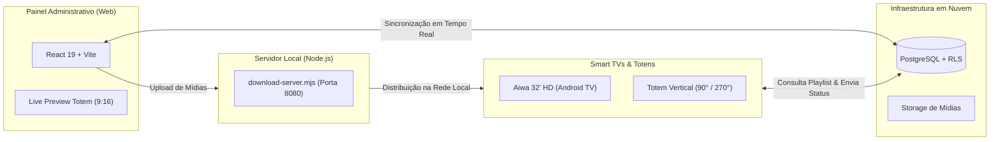

# Simper — Plataforma de Digital Signage & Mídia Indoor

[](https://github.com/simperapp/simper-app)
[](https://simperapp.github.io/simper-app/)
[](docs/INSTALLATION_ANDROID_TV.md)
[](supabase/)
[]()

> Plataforma centralizada para gestão, agendamento e reprodução contínua de campanhas publicitárias em Smart TVs comerciais e totens verticais (9:16).

---

## 📌 Visão Geral

O **simper.app** é um ecossistema completo para operações de Mídia Indoor corporativa e de varejo. Ele permite cadastrar telas remotas por código de pareamento numérico de 6 dígitos, atribuir grades de programação (playlists), carregar fotos e vídeos em alta definição, e monitorar o status de reprodução em tempo real.

O projeto foi projetado com arquitetura **Offline-First**: as Smart TVs baixam as mídias para o armazenamento interno local e mantêm a reprodução ininterrupta mesmo se a conexão com a internet oscilar ou cair completamente.

---

## 🏛️ Arquitetura do Sistema

```
simper-app/
├── admin-web/       # Painel Web Administrativo (React 19 + TypeScript + Tailwind CSS)
├── tv-player/       # Player Android TV Nativo (Kotlin + AndroidX Media3 / ExoPlayer)
├── supabase/        # Modelagem PostgreSQL, Migrations e Políticas de Segurança (RLS)
├── docs/            # Documentação arquitetural, guias de instalação e especificações
└── uploads/         # Repositório de arquivos de mídia servidos na rede local
```



---

## 📊 Matriz de Funcionalidades e Status Atual

> **Nota de Transparência:** Para manter rigor de engenharia, diferenciamos abaixo o que já foi codificado e testado do que está em fase de homologação contínua.

| Módulo | Recurso / Funcionalidade | Status | Validação Realizada |
| :--- | :--- | :---: | :--- |
| **Web Admin** | Autenticação administrativa com sessão persistente | ✅ Concluído | Validado no navegador |
| **Web Admin** | Live Preview do Totem Vertical (9:16) em tempo real | ✅ Concluído | Validado no navegador |
| **Web Admin** | Controle Remoto via Nuvem (Avançar, Voltar, Pausar/Play) | ✅ Concluído | Sincronizado com TV |
| **Web Admin** | Rotação de Orientação Remota (0°, 90°, 180°, 270°) | ✅ Concluído | Sincronizado com TV |
| **Web Admin** | Biblioteca de Mídias com suporte a Fotos e Vídeos (MP4) | ✅ Concluído | Testado local e web |
| **Web Admin** | Ajuste dinâmico de duração (5s, 10s, 30s) por anúncio | ✅ Concluído | Testado no ciclo |
| **Web Admin** | Tema Claro / Escuro Global com persistência e tokens | ✅ Concluído | Validado em Desktop & Mobile |
| **Web Admin** | Nova aba de Configurações (Aparência, Perfil, Reprodução, Diagnóstico) | ✅ Concluído | Validado no painel web |
| **TV Player** | Inicialização Automática no Boot (`BOOT_COMPLETED`) | ✅ Concluído | Validado em bancada de testes |
| **TV Player** | Retomada automática após Standby (`ACTION_SCREEN_ON`) | ✅ Concluído | Validado em bancada de testes |
| **TV Player** | Engine de Transições (`fade`, `cut`, `slide`, `zoom`) | ✅ Concluído | Validado em bancada de testes |
| **TV Player** | Suporte a teclas físicas do controle remoto da TV | ✅ Concluído | Validado em bancada de testes |
| **TV Player** | Testes de Estresse e Estabilidade Contínua 24/7 | ⏳ Em Homologação | Testes de longa duração em andamento |
| **Deploy** | GitHub Pages com rotas relativas automáticas | ✅ Concluído | Ativo em simperapp.github.io |

---

## 🚀 Instalação e Execução

### 1. Pré-Requisitos Gerais
- **Node.js**: v18.0.0 ou superior
- **JDK (Java Development Kit)**: Versão 17 (para compilar o app Android)
- **Android SDK**: Build Tools 34.0.0 (instalável via Android Studio ou CLI)
- **Git**

---

### 2. Painel Web Administrativo (`admin-web`)

```bash
# 1. Acesse o diretório
cd admin-web

# 2. Instale as dependências
npm install

# 3. Configure as variáveis de ambiente (opcional se rodar local)
cp .env.example .env

# 4. Inicie o servidor de desenvolvimento
npm run dev

# 5. O painel estará disponível em: http://localhost:5173
```

Para gerar a versão de produção:
```bash
npm run build
```

---

### 3. Servidor Local de Distribuição de Mídias (`download-server.mjs`)

O servidor local leve em Node.js gerencia a entrega de pacotes APK e faz o upload/distribuição de imagens e vídeos pesados na rede local da TV:

```bash
# Na raiz do projeto:
node download-server.mjs

# O servidor responderá na porta 8080:
# - http://<ip-do-pc>:8080/simper-tv.apk
# - http://<ip-do-pc>:8080/api/upload-media
```

---

### 4. Player Android TV (`tv-player`)

Para compilar e instalar o APK na Smart TV via rede ADB ou pendrive:

Consulte o guia passo a passo completo em:  
👉 **[Guia Detalhado de Instalação no Android TV (docs/INSTALLATION_ANDROID_TV.md)](docs/INSTALLATION_ANDROID_TV.md)**

Comandos rápidos para desenvolvedores:
```bash
cd tv-player

# Compilar pacote APK Debug
./gradlew assembleDebug

# Instalar na TV conectada via Wi-Fi/Ethernet
adb connect <IP_DA_SMART_TV>:5555
adb install -r app/build/outputs/apk/debug/app-debug.apk

# Iniciar o aplicativo na tela da TV
adb shell am start -n app.simper.tvplayer/.ui.MainActivity
```

---

## 🔒 Diretrizes de Segurança & Credenciais

1. **Chaves Administrativas Privadas**: Nenhuma chave com perfil `service_role` ou permissão de escrita administrativa é exposta no frontend web público ou no APK do Android.
2. **Políticas de Linha (RLS - Row Level Security)**: A comunicação com o Supabase utiliza a chave pública anônima (`anon key`), com restrições rígidas para que telas de TV possam apenas consultar a playlist vinculada ao seu respectivo `pairing_code` e registrar métricas de exibição.
3. **Variáveis de Ambiente**: Arquivos `.env` contendo credenciais locais estão permanentemente protegidos pelo `.gitignore` e nunca devem ser incluídos em commits.

---

## 📱 Hardware Homologado

- **Smart TV Modelo**: Aiwa AWS-TV-32-BL-02-A (32" HD)
- **Sistema Operacional**: Android TV 9.0 / 11.0 / Google TV
- **Formatos de Mídia Testados**:
  - Imagens: JPEG, PNG, WebP (resoluções até 1080x1920 para totens e 1920x1080 para TV horizontal).
  - Vídeos: MP4 (H.264 / AAC) e WebM.

---

## 📄 Licença e Propriedade

Projeto proprietário desenvolvido para **Simper Sistemas**. Todos os direitos reservados &copy; 2026.
