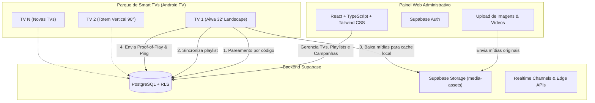

# Arquitetura do Sistema — simper.app

Plataforma comercial de **Digital Signage** (gerenciamento e reprodução contínua de anúncios em Smart TVs).

---

## 1. Visão Geral

O ecossistema **simper.app** é composto por três componentes principais:

---

## 2. Princípios de Engenharia & Resiliência

1. **Offline-First Absoluto**:
   - A TV **nunca** depende de conexão ativa para reproduzir anúncios que já foram baixados.
   - Uma interrupção de rede não interrompe o loop do ExoPlayer nem escurece a tela.
   - Pings e relatórios de reprodução (*Proof-of-Play*) são enfileirados localmente no SQLite/Room do Android e sincronizados quando a rede for restabelecida.

2. **Evitar Downloads Repetidos**:
   - Cada mídia cadastrada possui um hash `checksum_sha256` gerado no momento do upload.
   - A TV só realiza o download de um arquivo caso o arquivo local não exista ou seu checksum não confira com o registro do banco.

3. **Isolamento de Segurança (Zero Secret Exposure)**:
   - O aplicativo da TV **nunca** armazena `service_role_key` ou credenciais com privilégios de escrita administrativa.
   - O player da TV acessa apenas a API pública anônima do Supabase através de políticas restritivas de **Row Level Security (RLS)**.

4. **Tratamento de Orientação e Hardware**:
   - Smart TVs com painéis fixos (sem suporte a rotação por SO) utilizam rotação interna no viewport gráfico (`View.setRotation` e matriz de layout).
