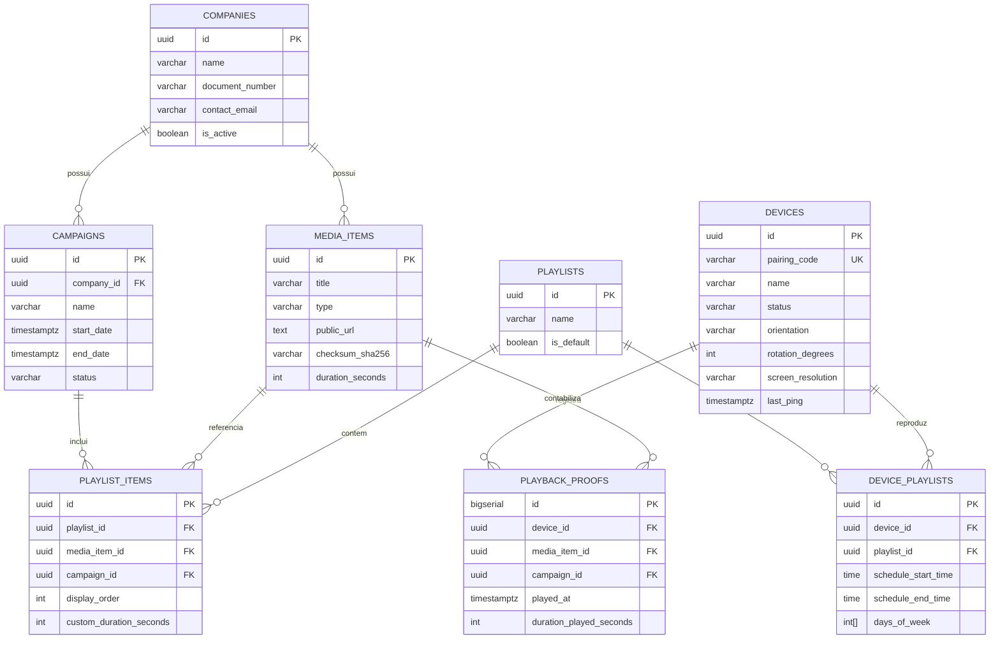

# Modelagem de Dados — simper.app

Modelagem relacional para PostgreSQL hospedado no Supabase com suporte a Row Level Security (RLS).

---

## 1. Diagrama Entidade-Relacionamento

---

## 2. Regras de Integridade e Índices

- **`devices.pairing_code`**: Código de 6 caracteres alfanuméricos com índice único para consulta instantânea durante a vinculação na TV.
- **`media_items.checksum_sha256`**: Índice de busca para deduplicação de mídias e verificação de cache no player.
- **`playback_proofs`**: Tabela append-only com indexação composta em `(device_id, played_at)` e `(campaign_id, played_at)` para relatórios de auditoria e métricas de faturamento para os anunciantes.
- **Row Level Security (RLS)**:
  - Usuários autenticados no painel web (Role `authenticated`) têm permissão integral de CRUD.
  - O player de TV (Role `anon`) tem permissão de leitura restrita à sua própria playlist e permissão de inserção de pings e comprovantes de reprodução.
